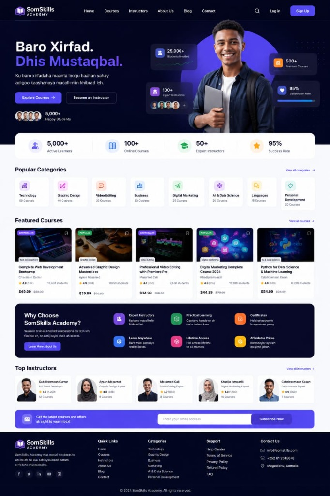

# Baro Academy (SomSkills Academy)

> **Enterprise Full-Stack E-Learning Platform** powered by ASP.NET Core (.NET 10), Entity Framework Core (SQLite / PostgreSQL / SQL Server), JWT Authentication, Role-Based Access Control, Real Lesson Player, and Somali Mobile Money payments.



---

## 🌟 Architecture & Engineering Report

### 1. Technology Stack
- **Backend**: ASP.NET Core Minimal API (.NET 10.0.402 SDK)
- **Database / ORM**: Entity Framework Core 10.0.13 with SQLite relational database (`baro_academy.db`), supporting zero-config local development and portable migration to PostgreSQL / SQL Server.
- **Authentication**: JWT Bearer Tokens (`System.IdentityModel.Tokens.Jwt`) + salted password hashing (`BCrypt.Net-Next`).
- **Authorization**: Role-Based Access Control (`Student`, `Instructor`, `Admin`).
- **Frontend**: Semantic HTML5, CSS3 Custom Properties (Design System, Plus Jakarta Sans typography, responsive layout), and Vanilla Reactive JavaScript (ES6+).
- **Payment Abstraction**: Multi-provider engine supporting **EVC Plus (Hormuud)**, **ZAAD (Telesom)**, **Sahal (Golis)**, and **Credit/Debit Card** with server-side price recalculation and idempotency.

---

## 🚀 Key Functional Modules

### 👨‍🎓 1. Student Dashboard & Learning Environment
- **Enrolled Courses**: View registered courses with real-time progress percentage indicators.
- **Interactive Lesson Player**:
  - Full-screen / split view with HTML5 video player.
  - Section and lesson curriculum navigation tree.
  - "Mark as Completed" button updating progress % in the database.
  - Previous / Next lesson navigation.
- **Certified Completion**: Automated certificate issuance (`SOM-CERT-XXXXXX`) when reaching 100% course progress.
- **Order & Receipt History**: Detailed transaction logs and payment method records.

### 👨‍🏫 2. Instructor Dashboard
- **Real Metrics**: Total courses, total students taught, total earnings ($), and review ratings.
- **Course Authoring**:
  - "+ Abuur Koorso Cusub" (Create New Course) form with title, Somali title, category, price, and description.
  - Instant publishing and section/lesson management.

### 🛡️ 3. Admin Portal
- **Platform Analytics**: Total registered users, total students, instructors, courses, and gross revenue.
- **Course Approvals & Publishing**: Review, approve, and publish instructor submissions.
- **Audit Logs**: Real-time record of all payment transactions, course updates, and subscriptions.

### 💳 4. Secure Checkout & Order State Machine
- **Server-Side Price Validation**: Never trusts totals computed on the client.
- **Pending -> Paid Lifecycle**: Creates pending orders, validates mobile-money reference or payment provider, and automatically grants course enrollment.

---

## 👥 Seeded Demo Accounts (One-Click Testing)

The database is pre-seeded with sample users for instant testing:

| Role | Email | Password | Features Accessible |
| :--- | :--- | :--- | :--- |
| **Student** | `student@somskills.com` | `Student123!` | Enrolled in Web Dev Bootcamp, Lesson Player, Certificates |
| **Instructor** | `cabdiraaxmaan.cumar@somskills.com` | `Instructor123!` | Instructor Dashboard, Create Course, View Earnings |
| **Admin** | `admin@somskills.com` | `Admin123!` | Admin Portal, Revenue Stats, Manage Courses & Users |

*(Inside the Login modal, you can also click the quick-login demo buttons for instant access).*

---

## ⚡ How to Run and Test

### 1. Launch the Application
Double-click `run.bat` or execute in PowerShell:
```powershell
.\run.bat
```
Visit `http://localhost:5000` in your web browser.

### 2. Run Automated Integration Tests
Execute the end-to-end test suite:
```powershell
powershell -ExecutionPolicy Bypass -File .\test-platform.ps1
```
All 7 platform test suites (Health, Auth, My Courses, Lesson Progress, Instructor Dashboard, Admin Portal, Frontend UI) will run and report status.

---

## 📁 Project Structure

```
baro academy/
├── Data/
│   └── AppDbContext.cs           # EF Core Database Context & Fluent API
├── Models/
│   ├── User.cs                   # User & Role Entities
│   ├── Course.cs                 # Course Entity & Status
│   ├── Category.cs               # Category Entity
│   ├── Learning.cs               # Section, Lesson, Enrollment, Progress, Certificate
│   ├── Commerce.cs               # Order, OrderItem, Review, Wishlist
│   └── Admin.cs                  # InstructorProfile, AuditLog, PlatformSetting
├── DTOs/
│   └── DataTransferObjects.cs    # Strongly typed Request/Response DTOs
├── Services/
│   ├── AuthService.cs            # BCrypt hashing & JWT Token generator
│   ├── PaymentService.cs         # Order management & Payment processing
│   └── DbInitializer.cs          # Database schema creation & initial seeding
├── wwwroot/
│   ├── index.html                # Responsive Web Client with Modals & Dashboards
│   ├── css/
│   │   ├── style.css             # Main stylesheet & Dashboard components
│   │   └── responsive.css        # Mobile, tablet, desktop media queries
│   └── js/
│       ├── app.js                # Full-Stack client engine & API integrations
│       ├── translations.js       # Somali & English bilingual dictionaries
│       └── data.js               # Offline data fallback
├── baro_academy.db               # SQLite Relational Database
├── Program.cs                    # ASP.NET Core Minimal API Endpoints
├── test-platform.ps1             # Automated Integration Test Suite
├── run.bat                       # One-click Windows launcher
└── README.md                     # Documentation
```
